# TP1-DAR2026: Les sockets en mode connecté TCP

**Nom Prénom** : Malak Ben Slim
**Matière** : Développement d'applications réparties, LSI 3

##### Activité 1-1: Première connexion Client/Serveur
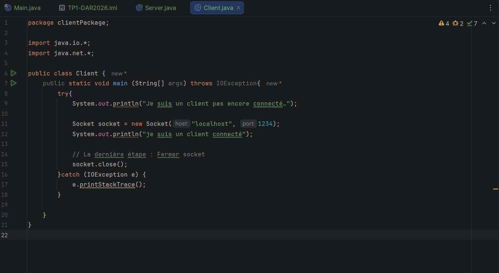
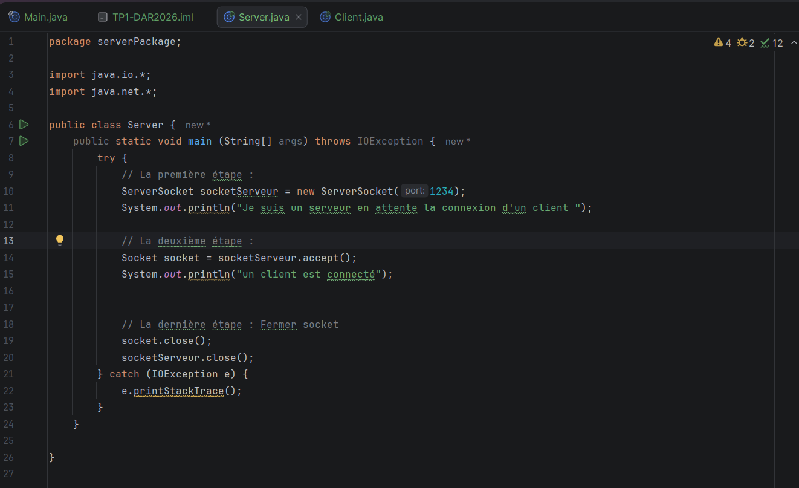

## Étape 1: Vérification de Git
Commande: `git --version`
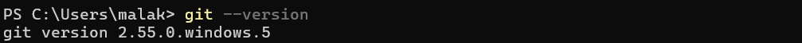

Description: Git est bien installé sur ma machine, la version est 2.55.0.windows.5

## Étape 2 : Vérification de Java
Commande : `java --version`
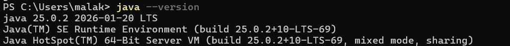

Description: Le JDK installé est en version 25.0.2 .

## Étape 3 : Création du serveur
Le package `serverPackage` contient la classe `Server` qui crée un `ServerSocket` sur le port 1234 et attend un client avec `accept()`.

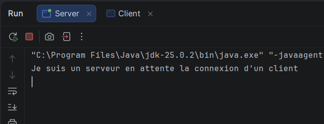

Interprétation: le serveur affiche "Je suis un serveur en attente..." puis reste bloqué sur `accept()` tant qu'aucun client ne se connecte.

## Étape 4 : Création du client
Le package `clientPackage` contient la classe `Client` qui se connecte au serveur avec `new Socket("localhost", 1234)`.

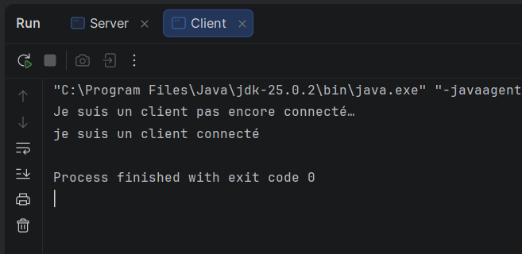

Interprétation : le client affiche d'abord "pas encore connecté", puis "je suis un client connecté" une fois la connexion acceptée.

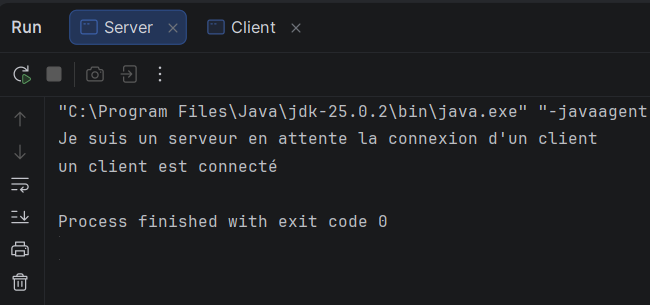

Interprétation : côté serveur, "un client est connecté" apparaît au moment où `accept()` se débloque.

##### Activité 1-2 : Service de calculatrice
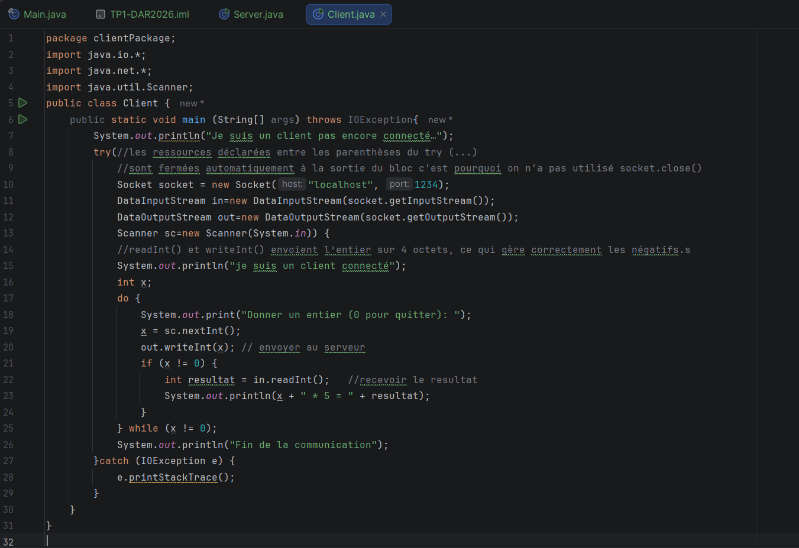
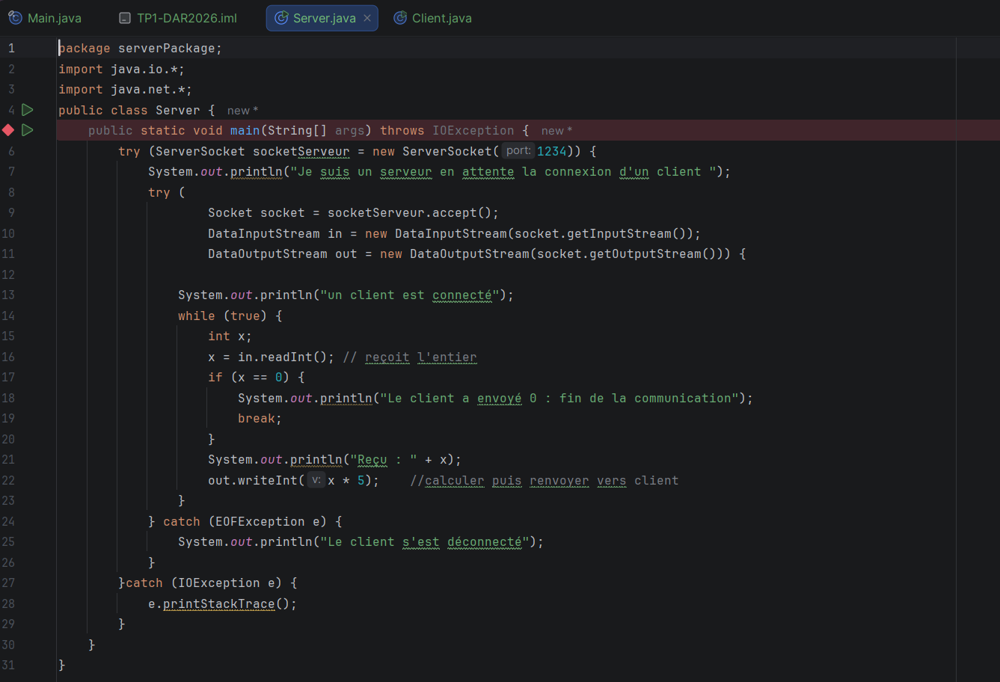

### Étape 1 : Préparation de l'espace de travail
Je continue dans le même projet `TP1-DAR2026` (packages `serverPackage` et `clientPackage`), en modifiant les classes `Server` et `Client` de l'activité 1-1.

### Étape 2 : Service de multiplication

#### Principe
- Le client saisit un entier `x` au clavier et l'envoie au serveur.
- Le serveur reçoit `x`, calcule `x * 5` et renvoie le résultat.
- Le client reçoit le résultat et l'affiche.

j’utilise DataInputStream et DataOutputStream à la place de InputStream/OutputStream. Ces classes permettent d’échanger des entiers complets sur 4 octets avec writeInt() et readInt(), ce qui permet de gérer correctement les nombres négatifs/grands nombres. Les flux simples ne transmettent qu’un octet (0 à 255) et faussent ces valeurs.

#### Lancement : le serveur d'abord, puis le client
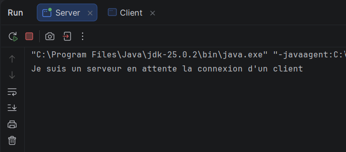
Interprétation : le serveur affiche "Je suis un serveur en attente la connexion d'un client" et reste bloqué sur `accept()`.

#### Test avec une valeur positive
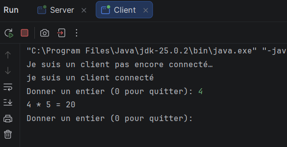
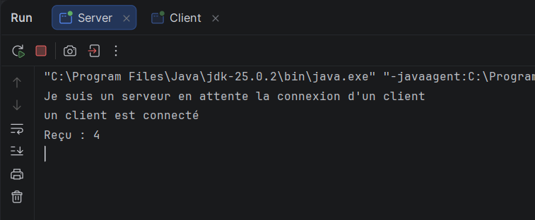

Interprétation : pour x =4, le client affiche `4 * 5 =20`. Le calcul est bien fait côté serveur, qui affiche `Reçu : 4`.

#### Test avec une valeur négative
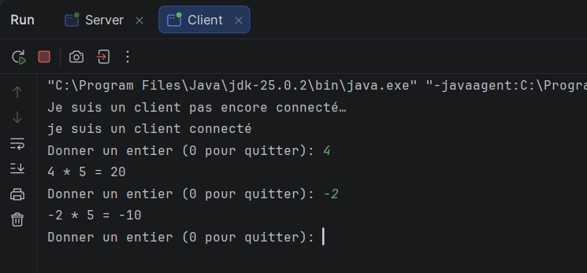
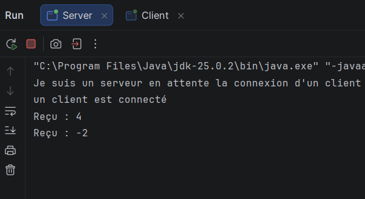

Interprétation : pour x = -2, le client affiche `-2 * 5 = -10`. Les négatifs sont bien transmis grâce à `writeInt()` / `readInt()`.

#### Test avec zéro : arrêt de la communication
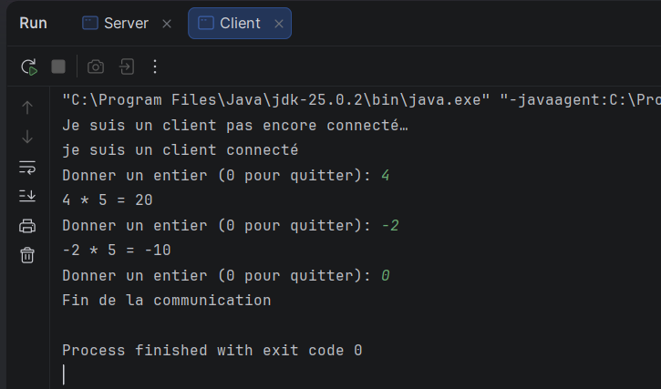
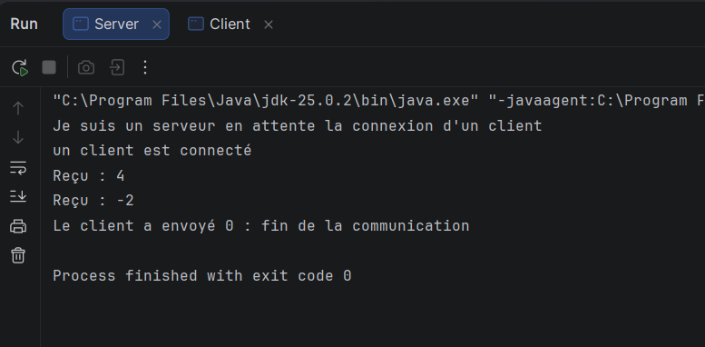

Interprétation : quand l'utilisateur saisit 0, le client l'envoie puis sort de la boucle et affiche "Fin de la communication". Le serveur détecte 0, affiche "Le client a envoyé 0 : fin de la communication" et sort de la boucle. Les sockets sont fermés des deux côtés automatiquement.

### Fermeture des sockets
Je n'ai pas écrit `socket.close()` : les sockets et les flux sont déclarés dans les parenthèses du `try-with-resources`, donc Java les ferme automatiquement à la sortie du bloc, même en cas d'exception.

### Remarques
- Le serveur doit toujours être lancé avant le client. Sinon, le client affiche `ConnectException: Connection refused`, car aucun `ServerSocket` n'écoute sur le port 1234.

##### Activité 1-3 : Amélioration sur le service de calculatrice 

### Étape 1 : Connexion avec l'adresse IP réelle

#### Principe
Avant (activité 1-2), `localhost` limitait la communication à une seule machine. Maintenant, serveur et client utilisent l'IP réelle du serveur (`192.168.1.108`) et le port 1234.

- `InetAddress` représente une adresse IP (créée en interne par `InetSocketAddress`).
- `InetSocketAddress` regroupe l'IP et le port.
- **Serveur** : `new ServerSocket()` puis `bind(new InetSocketAddress(IP_SERVEUR, PORT))`.
- **Client** : `connect(new InetSocketAddress(IP_SERVEUR, PORT), 5000)` (délai max 5 s).

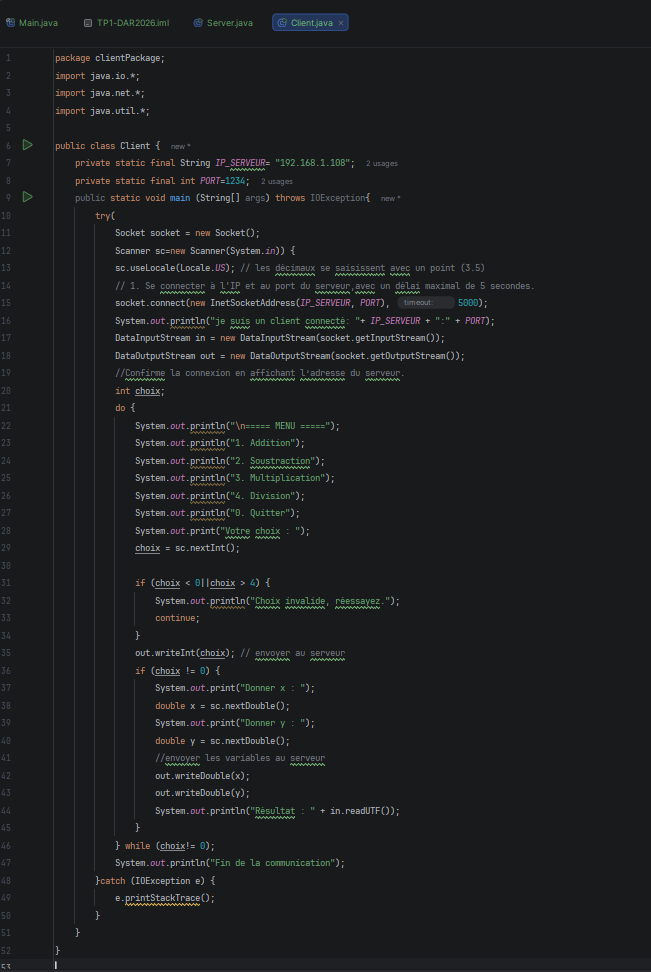
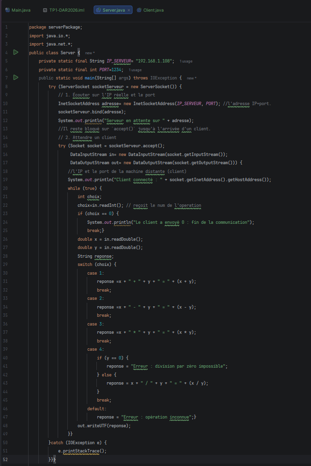

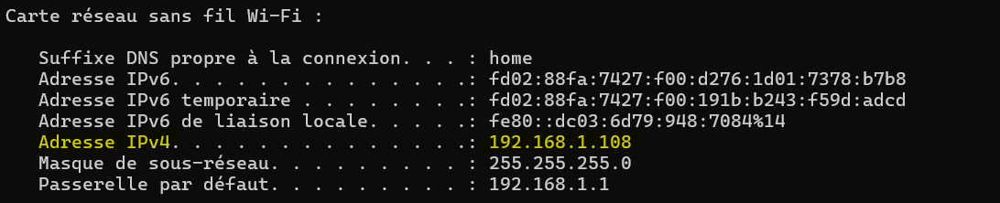
Description : `ipconfig` donne l'IPv4 `192.168.1.108`, utilisée dans `IP_SERVEUR`.

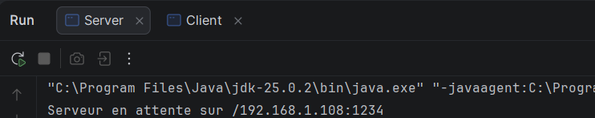
Interprétation : le serveur écoute sur `192.168.1.108:1234` et reste bloqué sur `accept()`.

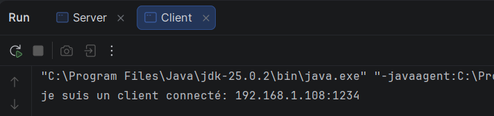
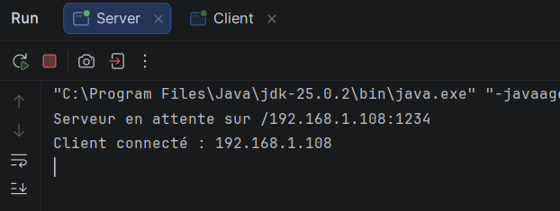
Interprétation : le client se connecte à `192.168.1.108:1234` et le serveur affiche `Client connecté : 192.168.1.108`.

#### Limite du test
Je n'ai pas pu disposer d'une deuxième machine : le test a donc été réalisé sur **une seule machine**, mais en utilisant l'**IP réelle du réseau** (`192.168.1.108`) à la place de `localhost`. La connexion passe ainsi par l'adresse réseau de la carte et non par l'adresse de boucle locale.

Le code est prêt pour deux machines distinctes. Il suffit de :
1. lancer `Server` sur la machine A (IP `192.168.1.108`),
2. lancer `Client` sur la machine B (même réseau), avec `IP_SERVEUR = "192.168.1.108"`,
3. autoriser Java dans le pare-feu de A (réseau privé).

Dans ce cas, le serveur affichera l'IP de B à la place de `192.168.1.108` dans `Client connecté : ...`.

### Étape 2 : Calculatrice à 4 opérations

#### Principe
Le client affiche un menu (1 Addition, 2 Soustraction, 3 Multiplication, 4 Division, 0 Quitter) et envoie le choix (`writeInt`) puis x et y (`writeDouble`). Le serveur calcule avec un `switch` et renvoie le résultat en texte (`writeUTF`). Le choix 0 ferme tout proprement (`try-with-resources`).

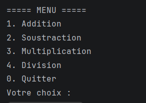

#### Tests

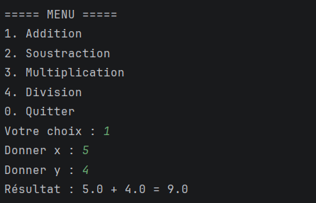
5 + 4 → `5.0 + 4.0 = 9.0`

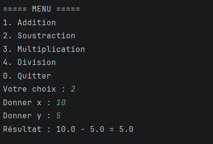
10 - 5 → `10.0 - 5.0 = 5.0`

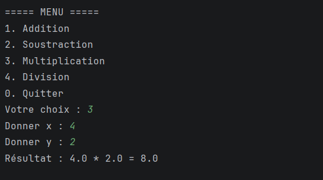
4 * 2 → `4.0 * 2.0 = 8.0`

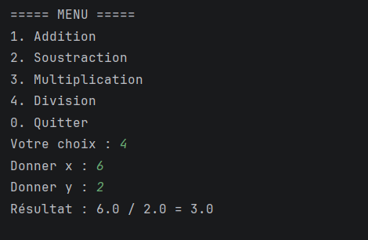
6 / 2 → `6.0 / 2.0 = 3.0`

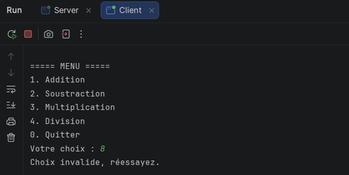
Choix 8 : le client affiche `Choix invalide, réessayez.` sans rien envoyer.

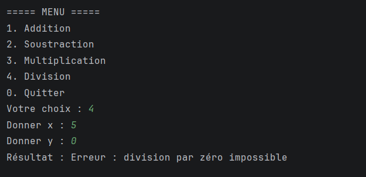
y = 0 : le serveur renvoie `Erreur : division par zéro impossible` sans planter.

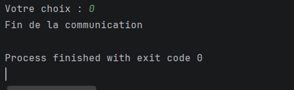
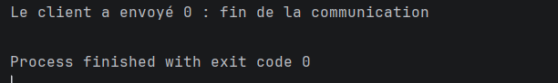
Choix 0 : le client affiche `Fin de la communication`, le serveur `Le client a envoyé 0 : fin de la communication`. Sockets fermés des deux côtés.

### Remarques
- Test réalisé sur **une seule machine** avec l'IP réelle. Pour deux machines : `Server` sur l'une, `Client` sur l'autre, avec l'IP du serveur dans `IP_SERVEUR`.
- `BindException` si l'IP du serveur n'est pas celle de la machine (utiliser `ipconfig`).
- Lancer le serveur avant le client.